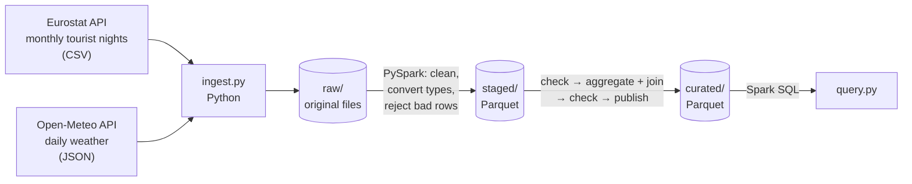

# Tourism and weather in Europe

In this project I built a small
data pipeline on Azure which takes tourism data from Eurostat and weather data
from Open-Meteo and puts them together into one table that can be queried
with SQL

My question was:

**Do more tourists come in the warmer and sunnier months?**

I checked this for 8 EU countries (Hungary, Austria, Czechia, Germany, Croatia,
Italy, Spain, Greece) between 2022 and 2024

What I found: yes, quite strongly. In the hot months (22 °C or more) the
countries have about 2 times more tourist nights than in an average month, and
in the cold months (under 5 °C) only about 0.6 times. The correlation between
temperature and tourist nights is between 0.86 and 0.96 in seven countries.
Austria is different (only 0.44).It is more likely because of the ski season in winter.


## Data sources

I used two public sources. Both are free and do not need any registration.

**1. Eurostat, dataset `tour_occ_nim`**
([link](https://ec.europa.eu/eurostat/databrowser/view/tour_occ_nim/default/table))
- Number of nights spent by tourists in all kinds of accommodation
  (hotels, holiday apartments, campsites), for all guests.
- Comes as CSV (SDMX-CSV format) from a REST API.
- One value per country per month.
- It is updated monthly, but with a delay of a few months. The newest values
  can be provisional, these are marked with a flag (for example `p`).

**2. Open-Meteo Historical Weather API**
([link](https://open-meteo.com/en/docs/historical-weather-api))
- Daily mean temperature, precipitation and sunshine duration.
- Comes as JSON from a REST API.
- One value per day for a given location (latitude, longitude).
- I used the capital city of every country as the location.

**How I combined them:** the weather is daily but the tourism data is monthly,
so first I aggregated the weather to monthly values. After that I joined the two
datasets on `country_code` and `month`. I use the Eurostat country codes
everywhere (Greece is `EL` in Eurostat, not `GR`, this was a small trap).

**Limitations**
- The weather of the capital stands for the whole country. For example the
  weather in Madrid is not the same as on the Spanish beaches, so this is only
  an approximation.
- Of course not only the weather matters, holidays and school breaks are also
  in summer. So the result shows correlation, not causation.
- There is no personal data in the sources, Eurostat data is already
  aggregated. Eurostat data can be reused with acknowledgement.


## Architecture



Every script is running on one Azure Linux VM, with PySpark in local mode.
The data of all three layers is stored in Azure Data Lake Storage Gen2, in a
container called `tourism`:

```text
raw/
  eurostat/tour_occ_nim.csv        the Eurostat response, unchanged
  weather/<CODE>.json              the Open-Meteo response for each country, unchanged
staged/
  tourism_monthly/                 cleaned tourism data (Parquet)
  weather_daily/                   one row per country and day (Parquet)
  rejected/tourism, rejected/weather   the bad rows with the reason
curated/
  tourism_weather_monthly/         the final table, this is the data product
```

The pipeline (`run_pipeline.py`) does these steps in this order:

1. **ingest**: downloads both sources and saves them into `raw/` without any change
2. **stage**: reads the raw files with PySpark, converts the types, makes one row
   per day from the weather JSON and puts the bad rows into `rejected/`
3. **validate staged**: quality checks on the staged tables
4. **build curated**: daily weather to monthly, join on country + month, adds
   the country names and the seasonality index
5. **validate curated**: quality checks on the final table
6. **publish**: writes the curated table, but only if step 5 was OK


## Technologies

- **Azure Data Lake Storage Gen2** for the raw, staged and curated data
  (Storage Account with hierarchical namespace)
- **Azure Linux VM** for running everything
- **PySpark 3.5** in local mode for the processing
- **Python** with `requests` and `azure-storage-blob` for the ingestion
- **Parquet** as file format
- **Spark SQL** for the queries
- **unittest** for the tests


## Files in the repository

```text
config.py               all settings (countries, period, paths, thresholds)
common.py               logging, Spark session, saving raw files
ingest.py               step 1, download into raw/
transform.py            PySpark transformations (steps 2, 4, 6)
validate.py             data quality checks (steps 3, 5)
run_pipeline.py         runs all steps with one command
query.py                Spark SQL queries on the final table
sql/example_queries.sql example queries
tests/test_pipeline.py  unit tests
.env.example            template for the Azure settings
DATA_PRODUCT.md         description of the final table
```


## Azure resources

I created these manually in the Azure Portal:

- **Resource group:** `rg-tourism-pipeline`, region Poland Central
- **Storage account:** Standard, LRS, with **hierarchical namespace turned on**
  (so it is ADLS Gen2). Inside it a private container named `tourism`.
- **Virtual machine:** Ubuntu Server 24.04 LTS (from Canonical), size
  `Standard_B2als_v2` (2 vCPU, 4 GB RAM), login with SSH key, only port 22 is
  open, Standard SSD disk.

I did not use the free `B2ats_v2` size because it has only 1 GB RAM, and this
is too little for Spark in my opinion.


## Configuration

The pipeline reads three environment variables. There is a template for them
in `.env.example`:

- `AZURE_STORAGE_ACCOUNT`: name of the storage account. **If it is not set,
  the pipeline runs locally and writes into the `./data` folder.**
- `AZURE_STORAGE_KEY`: access key of the storage account
  (Portal → Storage account → Access keys)
- `AZURE_STORAGE_CONTAINER`: name of the container, default is `tourism`


## How to run

### On my own computer (local mode)

You need Python 3.9 or newer and Java 17.

```bash
python3 -m venv .venv
source .venv/bin/activate
pip install -r requirements.txt

python run_pipeline.py
python query.py
```

### On the Azure VM

Setup, only once:

```bash
ssh -i ~/.ssh/<key>.pem azureuser@<vm-public-ip>

sudo apt update
sudo apt install -y openjdk-17-jre-headless python3-venv python3-pip git

git clone https://github.com/<user>/<repo>.git
cd <repo>
python3 -m venv .venv
source .venv/bin/activate
pip install -r requirements.txt
```

Then copy the `.env` file from your computer to the VM:

```bash
scp -i ~/.ssh/<key>.pem .env azureuser@<vm-public-ip>:~/<repo>/.env
```

Running the pipeline:

```bash
source .venv/bin/activate
source .env
python run_pipeline.py                 # download the data and process it
python run_pipeline.py --skip-ingest   # no download, uses the raw files already in storage
python query.py                        # runs the example queries
python query.py "SELECT * FROM tourism_weather LIMIT 5"
```

At the first run Spark downloads the `hadoop-azure` package, this is needed
to reach the Azure storage. It takes about one minute, but only the first time.

### Tests

```bash
python -m unittest discover -s tests -v
```


## Data quality and reliability

- **Retry:** if the download fails because of a network problem or a server
  error (5xx), it tries again 3 times. If the error is 4xx, it stops at once,
  because then the request itself is wrong.
- **Bad rows:** I do not drop bad rows silently. They go to `staged/rejected/`
  together with the reason, and a WARNING is printed.
- **Quality checks:** there are ERROR and WARNING checks. If an ERROR check
  fails, the pipeline stops. The full list is in [DATA_PRODUCT.md](DATA_PRODUCT.md).
- **Checking before publishing:** the curated table is only written if all
  checks are OK. So if something goes wrong, the old good table stays there.
- **Running it again is safe:** the raw files always have the same names and
  the tables are written with `mode("overwrite")`, so there are never
  duplicated rows.
- **Logging:** every step prints when it starts, if it was OK and how long it
  took. If it fails, the reason is printed too.


## Why I did it like this

- **One VM instead of Databricks:** the data is small (less than 10,000 rows),
  so one VM with Spark in local mode is enough. It is the simplest and also
  the cheapest way to run Spark in the cloud.
- **Parquet instead of CSV:** it is compressed, it is stored by columns, and
  it keeps the data types (a date stays a date).
- **Overwrite everything instead of incremental loading:** the data is small,
  and Eurostat sometimes corrects older values. If I compute everything again,
  the result is always consistent.
- **LEFT join and then a join check:** with an INNER join a month without
  weather data would just disappear and nobody would notice. With a LEFT join
  the row stays there with empty values, and the validation stops the pipeline.
- **Seasonality index:** Germany has many more tourists than Croatia, so the
  raw numbers cannot be compared. The index (nights of the month divided by
  the average month of that country) makes them comparable.
- **Same code locally and on Azure:** only the storage path is different
  (set by environment variables), so I could develop on my laptop and run the
  same code in the cloud.

